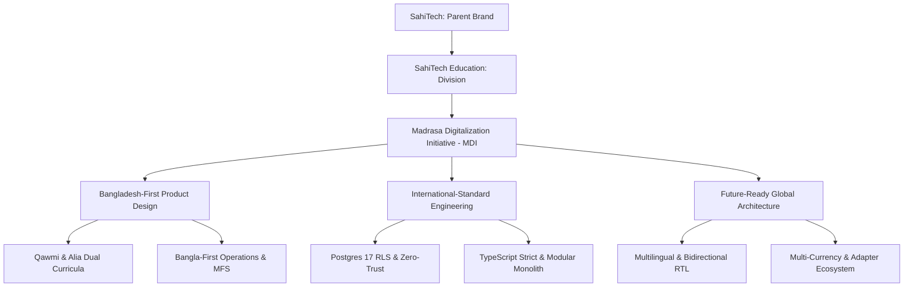

# 01. Project Overview & Strategic Positioning

**Parent Brand**: SahiTech  
**Division**: SahiTech Education  
**Initiative**: Madrasa Digitalization Initiative (MDI)  
**Official Positioning**: *SahiTech Education — An Education Initiative of SahiTech*  
**Tagline**: *Empowering Madrasas Through Technology.*  

---

## 1. Executive Mission
The Madrasa Digitalization Initiative (MDI) is an enterprise-grade, international-standard education management and institutional operating ecosystem. It unifies administrative governance, dual-engine academic curricula, student life, financial ledgers, and public engagement into a single, cohesive, hybrid multi-tenant platform.

Initially focused on the traditional (*Qawmi* / Dars-e-Nizami) and board-affiliated (*Alia* / BMEB) Islamic educational institutions of Bangladesh, MDI is engineered from day one to support international Islamic educational networks across South Asia, the GCC, and the broader Muslim world.

---

## 2. Strategic Brand & Legal Definition
- **Branded Initiative**: SahiTech Education is a specialized educational division under the corporate umbrella of SahiTech.
- **Legal Entity Representation**: SahiTech Education is not represented as an independently registered legal entity, NGO, foundation, or charity unless formally incorporated.
- **Commercial & Ethical Integrity**: The initiative operates with strict adherence to Shariah principles regarding interest-free financial operations, proper separation of charitable funds (Zakat, Fitrah, Sadqah), and strict user data privacy.

---

## 3. Bangladesh-First, International-Ready Strategy

### 3.1 Bangladesh-First Reality
- Deep compatibility with local madrasa customs: oral examinations, term periods (*Chala*), Kitab allocations, Lillah student feeding subsidies, and Shoora committee reporting.
- Mobile financial services integration (bKash, Nagad, Rocket) and cash-counter voucher workflows.
- Low-bandwidth optimization for rural campuses with intermittent cellular coverage.

### 3.2 International-Ready Capabilities
- Complete abstraction of currency (`currency_code`, integer minor units).
- Configurable academic calendars (Gregorian, Hijri, Lunar offsets).
- Universal time-zone handling (`TIMESTAMPTZ` UTC storage).
- Decoupled notification and payment provider adapter interfaces.

