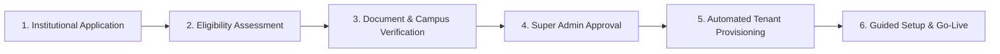

# 02. Product & Business Requirements

**Program**: Madrasa Digitalization Initiative (MDI)  
**Parent Brand**: SahiTech  
**Division**: SahiTech Education  

---

## 1. Market Analysis & Target Segments

Bangladesh is home to tens of thousands of Islamic educational institutions educating millions of students:
1. **Qawmi Madrasas**: Historically community-funded, independent of state curriculum, governed under Befaqul Madarisil Arabia Bangladesh and Al-Haiatul Ulya. Characterized by high residential ratios, classical Dars-e-Nizami syllabus, and substantial charitable (*Lillah*) student feeding.
2. **Alia Madrasas**: Registered under the Bangladesh Madrasa Education Board (BMEB) and Islamic Arabic University. Combines general education with Islamic curricula, following national GPA grading and board examinations (Dakhil, Alim, Kamil).
3. **Integrated & Dual-Wing Institutions**: Modern madrasas operating both a Qawmi Hifz/Kitab wing and a registered Alia board wing under a unified campus administration.

---

## 2. Institutional Pilot Program Eligibility

The initial deployment will be conducted with **3 to 5 pilot madrasas**, with the architecture designed to scale seamlessly to **100+ institutions**:

### Configurable Eligibility Criteria:
- **Operational Track Record**: Minimum 6 months of continuous academic operation.
- **Student Enrollment**: Minimum 100 enrolled students.
- **Physical Verification**: Valid institutional identity, board affiliation or Befaq registration, and operating committee approval.
- **Infrastructure**: At least one working desktop or laptop and stable internet connectivity.
- **Designated Digital Admin**: A nominated focal person (teacher or office staff) committed to training and platform operation.

---

## 3. Business Model & Sustainability Blueprint

MDI is designed as an ethically sustainable, tiered Software-as-a-Service (SaaS) platform:

| Tier | Target Profile | Pricing Model | Features & Limits |
| :--- | :--- | :--- | :--- |
| **Tier 0: Pilot / Sponsored** | 3–5 Pilot Institutions & Needy Madrasas | 100% Free / Subsidized | Core SIS, Attendance, Dual Academic Engine, Standard Reports. |
| **Tier 1: Standard Madrasa** | Autonomous single-campus institutions | Affordable Monthly/Annual BDT Subscription | Full MIS, Double-Entry Finance, Website CMS, Document Vault, Standard Support. |
| **Tier 2: Multi-Branch Jamia** | Large network institutions with 2+ branches | Tiered Enterprise BDT Subscription | Multi-branch consolidation, custom domain SSL, priority support, API integrations. |
| **Usage Add-ons** | All Tiers | Pay-as-you-go | Outbound SMS bundles, extra document storage, custom Sanad calligraphy templates. |

