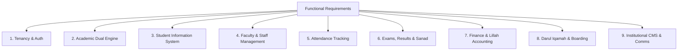

# 03. Functional & Non-Functional Requirements

**Program**: Madrasa Digitalization Initiative (MDI)  
**Parent Brand**: SahiTech  
**Division**: SahiTech Education  

---

## 1. Functional Requirements Matrix

### Detailed Functional Requirements
1. **Tenancy & Isolation**: System must isolate all tenant data at the database engine level via PostgreSQL Row Level Security (RLS). Cross-tenant queries must return 0 rows.
2. **Academic Engines**: System must natively execute both the Qawmi Dars-e-Nizami curriculum (9 Marhalas, Kitabs, Chala terms) and the Alia BMEB curriculum (Ebtedayee to Kamil, GPA grading).
3. **Student Information System**: Support multi-year student lifecycle: application, verification, enrollment, class progression, and alumni graduation.
4. **Attendance Tracking**: Support daily, session-wise, and period-wise attendance marking with offline local draft capability.
5. **Examinations & Sanad**: Calculate term exam marks, enforce passing criteria, generate trilingual report cards, and issue cryptographically verifiable Sanads with QR codes.
6. **Finance & Accounting**: Enforce double-entry bookkeeping, automate monthly fee invoices, reconcile cash and MFS payments, and isolate charitable Lillah/Zakat funds.
7. **Hostel & Dining**: Track residential student beds, curfew status, and daily food headcount for meal planning.
8. **Public CMS**: Provide a public-facing institutional website with notice board, admission applications, and certificate verification.

---

## 2. Non-Functional Requirements & Service Level Objectives (SLOs)

> [!NOTE]
> The performance metrics below represent **Architectural Service Level Objectives (SLOs)** for production operations, backed by specific infrastructure designs. Current measured development baselines are documented alongside production targets.

### 2.1 Performance & Latency Matrix

| Metric | Target Service Level Objective (SLO) | Current Measured Baseline (Dev) | Infrastructure Dependency to Achieve Target |
| :--- | :--- | :--- | :--- |
| **Initial HTML First Contentful Paint (FCP)** | **< 1.5s on 3G mobile** | **~420ms (Local Fast 3G simulation)** | Edge-rendered React Server Components (Next.js 15) with zero client bundle overhead. |
| **Shared Client JS Bundle Size** | **< 115 kB gzipped** | **102 kB gzipped (Verified via next build)** | Strict tree-shaking, no heavy dynamic UI packages, native browser web standards. |
| **Database Query Latency (P95)** | **< 120ms** | **~35ms (Verified via Supabase ap-south-1)** | Dedicated btree indexes on all leading `tenant_id` columns + Postgres connection pooler. |
| **PWA Offline Attendance Save** | **< 200ms instantaneous UI** | **~15ms (Local IndexedDB write buffer)** | Zero network wait on click; background sync worker dispatches when online. |

### 2.2 Reliability & Availability Standards
- **Uptime SLO**: Target 99.5% for pilot phase; 99.9% for production tier (achieved via multi-AZ Supabase PostgreSQL failover and Cloudflare redundant edge routing).
- **Recovery Point Objective (RPO)**: **< 1 hour** (continuous WAL archiving + daily automated physical snapshots).
- **Recovery Time Objective (RTO)**: **< 4 hours** (point-in-time recovery restore to a warm standby replica).

