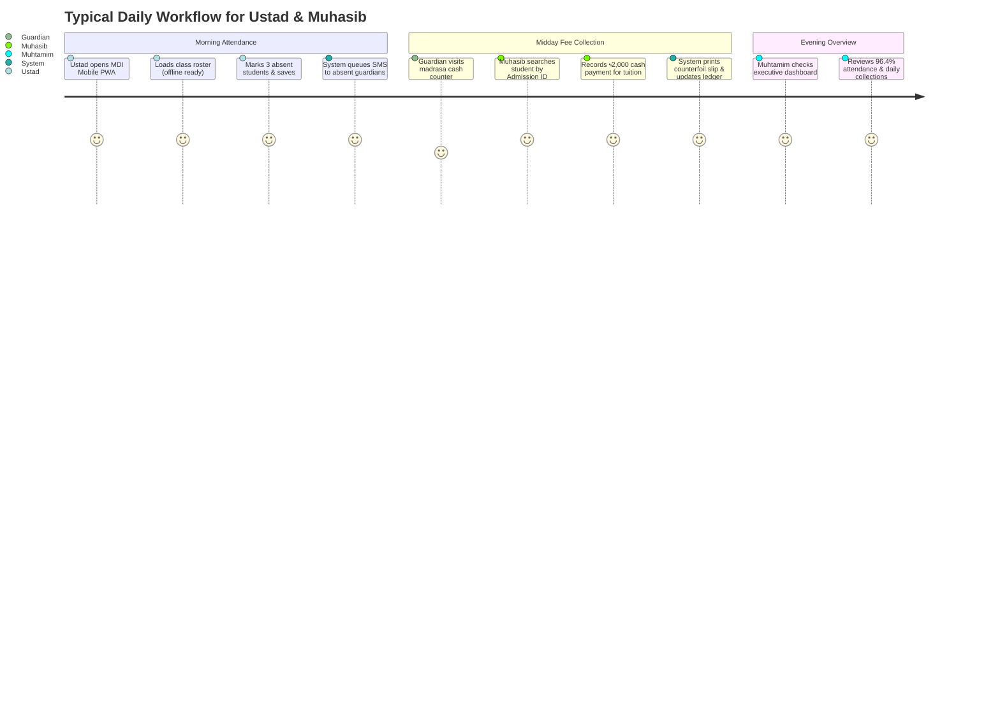

# 04. User Personas & Journeys

**Program**: Madrasa Digitalization Initiative (MDI)  
**Parent Brand**: SahiTech  
**Division**: SahiTech Education  

---

## 1. Primary User Personas

### 1.1 Muhtamim / Principal (Institutional Head)
- **Profile**: Senior Islamic scholar with deep community respect. Experienced in institutional governance; limited formal technical background.
- **Primary Goal**: Immediate visibility into institution health: total enrollment, daily attendance percentages, collection deficits, and upcoming term exams.
- **Key Pain Point**: Fragmented paper registers, lack of financial clarity, delayed exam result publication.
- **Preferred Device**: Android smartphone or office desktop.

### 1.2 Nazim-e-Taleemat (Academic Dean)
- **Profile**: Scholarly administrator overseeing curricula, Kitab distribution, class timetables, and teacher assignments.
- **Primary Goal**: Seamless class routine management, term exam scheduling, marksheet verification, and graduation Sanad generation.
- **Key Pain Point**: Labor-intensive calculation of exam positions and manual handwritten Sanads prone to errors.

### 1.3 Ustad / Muallim (Teacher)
- **Profile**: Classroom instructor teaching 30–60 students per period across multiple Kitabs.
- **Primary Goal**: Record class attendance within 60 seconds and input term exam marks without friction.
- **Key Pain Point**: Poor classroom internet connectivity; burdensome manual attendance roll books.

### 1.4 Muhasib (Accountant / Bursar)
- **Profile**: Financial manager handling fee collections, student fee concessions, cash registers, and teacher salary disbursements.
- **Primary Goal**: Fast payment receipt generation, cash reconciliation, and strict separation of general funds from Lillah/Zakat donations.
- **Key Pain Point**: Lost counterfoils, untracked fee defaulters, and difficult year-end audit reports for the Shoora committee.

### 1.5 Nazim-e-Darul-Iqamah (Hostel Warden)
- **Profile**: Oversees 24/7 residential life, dormitories, student safety, and kitchen mess food allocation.
- **Primary Goal**: Accurate daily meal counts to prevent food waste; immediate absentee alerts during night curfew.

### 1.6 Talib-e-Ilm (Student) & Abhibhabok (Guardian)
- **Profile**: Students and parents tracking academic progress, syllabus completion, exam results, and fee payment balances.
- **Primary Goal**: Instant access to results via smartphone and hassle-free online fee payments via bKash/Nagad.

---

## 2. Daily User Journeys

---

## 3. Institution administrator sign-in and sign-out journey

1. A manually provisioned Madrasa Admin signs in with the platform-issued MDI Login ID and temporary password. The applicant's submitted contact email is not the login identifier for this workflow.
2. On first login, the Admin changes the temporary password before tenant features become available.
3. The server resolves the account's active tenant membership. One membership is selected automatically; multiple memberships require an explicit institution selection.
4. The Admin enters the Madrasa workspace only after the selected membership, tenant lifecycle and role are validated server-side and by database RLS.
5. The Admin can sign out from the shared desktop header, workspace Sidebar or mobile navigation. Sign-out ends the Supabase session and removes the selected-tenant cookie.

Invitation-based accounts follow the separate verified-email invitation acceptance journey; an invitation token is not used by the email-independent manual-admin workflow.

## 4. Public institution website and admission journey

1. Each active Madrasa has a unique public path, `https://sahitech.dpdns.org/m/{subdomain}`, based on its unique tenant slug.
2. The institution can share that exact URL on its Facebook Page, prospectus and other public channels. The link is public and does not require an MDI staff login.
3. Visitors see that institution's profile and its own public notices. The notice query is scoped to the resolved tenant and public notices only.
4. A prospective family submits an online admission application from that institution's page. The server verifies that the supplied tenant ID and URL slug identify the same active institution.
5. The application enters the tenant's admissions workflow. Authorized admission staff review and evaluate it; an accepted application is then enrolled as a student by the institution's authorized staff.

**Student/Guardian account status:** a public application is not a student login account. The current Production schema has an optional `students.user_id` link, but no verified student/guardian account-provisioning and sign-in journey has been confirmed. Student/Guardian login must be built as a separate, identity-verified workflow after admission, with tenant-scoped memberships and guardian-to-student relationship checks.
