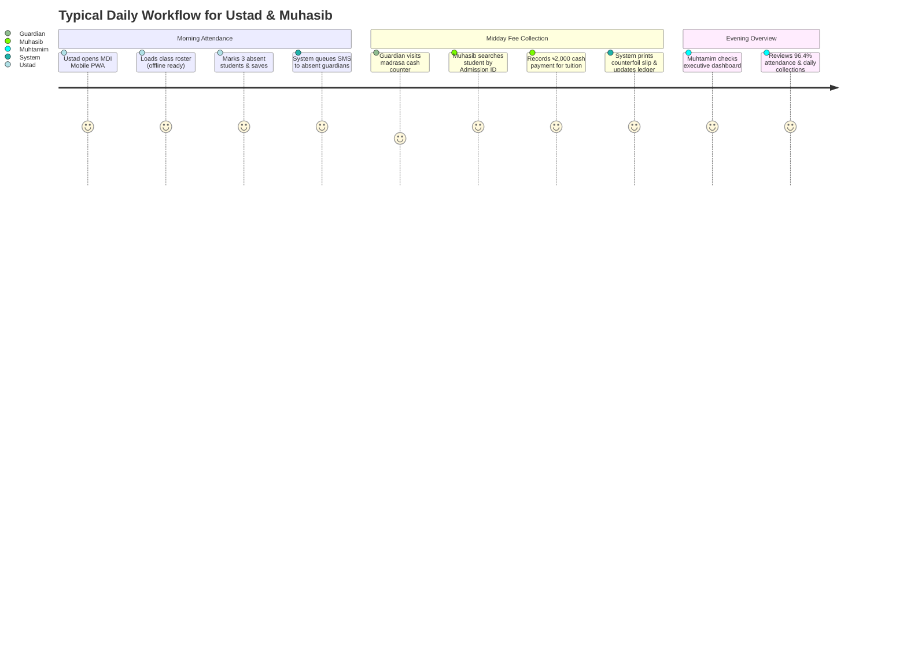

# 04. User Personas & Journeys

**Program**: Madrasa Digitalization Initiative (MDI)  
**Parent Brand**: SahiTech  
**Division**: SahiTech Education  

---

## 1. Primary User Personas

### 1.1 Muhtamim / Principal (Institutional Head)
- **Profile**: Senior Islamic scholar with deep community respect. Experienced in institutional governance; limited formal technical background.
- **Primary Goal**: Immediate visibility into institution health: total enrollment, daily attendance percentages, collection deficits, and upcoming term exams.
- **Key Pain Point**: Fragmented paper registers, lack of financial clarity, delayed exam result publication.
- **Preferred Device**: Android smartphone or office desktop.

### 1.2 Nazim-e-Taleemat (Academic Dean)
- **Profile**: Scholarly administrator overseeing curricula, Kitab distribution, class timetables, and teacher assignments.
- **Primary Goal**: Seamless class routine management, term exam scheduling, marksheet verification, and graduation Sanad generation.
- **Key Pain Point**: Labor-intensive calculation of exam positions and manual handwritten Sanads prone to errors.

### 1.3 Ustad / Muallim (Teacher)
- **Profile**: Classroom instructor teaching 30–60 students per period across multiple Kitabs.
- **Primary Goal**: Record class attendance within 60 seconds and input term exam marks without friction.
- **Key Pain Point**: Poor classroom internet connectivity; burdensome manual attendance roll books.

### 1.4 Muhasib (Accountant / Bursar)
- **Profile**: Financial manager handling fee collections, student fee concessions, cash registers, and teacher salary disbursements.
- **Primary Goal**: Fast payment receipt generation, cash reconciliation, and strict separation of general funds from Lillah/Zakat donations.
- **Key Pain Point**: Lost counterfoils, untracked fee defaulters, and difficult year-end audit reports for the Shoora committee.

### 1.5 Nazim-e-Darul-Iqamah (Hostel Warden)
- **Profile**: Oversees 24/7 residential life, dormitories, student safety, and kitchen mess food allocation.
- **Primary Goal**: Accurate daily meal counts to prevent food waste; immediate absentee alerts during night curfew.

### 1.6 Talib-e-Ilm (Student) & Abhibhabok (Guardian)
- **Profile**: Students and parents tracking academic progress, syllabus completion, exam results, and fee payment balances.
- **Primary Goal**: Instant access to results via smartphone and hassle-free online fee payments via bKash/Nagad.

---

## 2. Daily User Journeys

