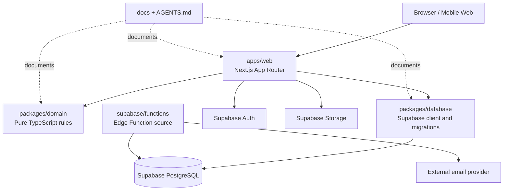

# 06. System Architecture & Topology

**Program:** Madrasa Digitalization Initiative (MDI)  
**Parent brand:** SahiTech  
**Division:** SahiTech Education  
**Architecture style:** Domain-Driven Modular Monolith in a pnpm workspace

## 1. Runtime overview

The repository separates the Next.js web application, portable domain rules, database integration/migrations and Supabase Edge Function source. This is not currently a microservices system.



This diagram is a repository-level conceptual view. It does not prove that every external provider or Edge Function is deployed, scheduled or operational.

## 2. Actual repository layout

```
SahiTech-Education/
├── apps/
│   └── web/              # Next.js App Router application
├── packages/
│   ├── domain/           # Domain types and business rules
│   └── database/         # Supabase client package and SQL migrations
├── supabase/
│   └── functions/        # Supabase Edge Function source
├── docs/                 # Product, design, engineering and operations docs
├── .github/workflows/    # CI workflow
├── AGENTS.md             # Coding-agent and documentation rules
└── package.json          # pnpm workspace root
```

No standalone `packages/ui` or `@sahitech/ui` workspace package was present at the reviewed commit.

## 3. Dependency boundaries

1. `packages/domain` owns portable business rules and should not depend on Next.js, React or Supabase runtime APIs.
2. `apps/web` owns route rendering, server actions, auth/session integration and user interaction.
3. `packages/database` owns database integration code and ordered SQL migrations. Database authorization must be enforced in PostgreSQL as well as application logic.
4. `supabase/functions` contains independently deployed function source. Source presence does not prove deployment or scheduling.
5. Documentation and ADRs describe intended behavior but must be kept aligned with code and verified environment state.

Avoid circular dependencies. Keep service/provider SDKs behind a server-side adapter where practical.

## 4. Security boundaries

- The browser is untrusted. Never authorize access using a client-provided tenant ID, role, email claim or local state.
- Server actions and route handlers must authenticate the user, resolve authorized tenant context and validate inputs.
- Database access must use least-privilege grants, RLS, safe function grants and tenant-aware foreign keys.
- Service-role secrets remain server-only.
- Public endpoints require explicit abuse controls and minimal response payloads.
- Privileged asynchronous jobs need explicit tenant scope, idempotency, bounded retries and auditability.

See documents 08–11 and 27 for detail.

## 5. Localization and user interface

The web app has Bangla, English and Arabic TypeScript dictionary modules. The root layout resolves locale and direction and uses a shared Navbar/I18nProvider. Do not assume all routes are fully translated or all Arabic RTL states have been browser-tested without evidence.

## 6. Data and provider topology

Supabase PostgreSQL, Auth and Storage are the current integration target. Repository configuration also includes email outbox/Edge Function source. Payment, SMS, PWA, AI/OCR and other integrations described elsewhere must be labelled planned or not verified unless current code and a real integration test prove them.

## 7. Deployment portability

The app uses Next.js and can be operated in supported Node-compatible hosting environments; verify runtime requirements against actual Next.js and Supabase dependencies before changing infrastructure. Keep environment-specific values outside source control. Production migrations, secrets, Auth settings, DNS and deployments require explicit authorization.

## 8. Change discipline

Architectural boundary changes require an ADR. Any code or migration change must follow [Documentation Sync Policy](DOCUMENTATION_SYNC_POLICY.md), update affected specs and preserve production release gates.
