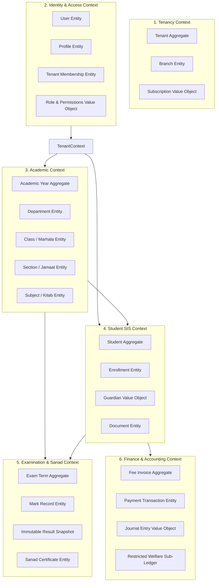

# 07. Domain Architecture & Bounded Contexts

**Program**: Madrasa Digitalization Initiative (MDI)  
**Parent Brand**: SahiTech  
**Division**: SahiTech Education  

---

## 1. Domain-Driven Design (DDD) Bounded Contexts

---

## 2. Aggregates & Domain Invariants

### 2.1 Academic Aggregate
- **Root**: `AcademicYear`
- **Invariants**:
  - `start_date` must precede `end_date`.
  - Only one `AcademicYear` can be marked as `is_current = true` per tenant at any given time.
  - A `Class` cannot exist without an active `Department`.
  - A `Section` capacity cannot be exceeded during enrollment without explicit administrative override.

### 2.2 Student Aggregate
- **Root**: `Student`
- **Invariants**:
  - `admission_no` must be unique within the tenant.
  - A student cannot have more than one active `Enrollment` in the same `AcademicYear`.
  - `is_residential = true` is a prerequisite for boarding room allocation.
  - `is_lillah_boarder = true` automatically marks the student eligible for subsidized meal funding.

### 2.3 Evaluation & Sanad Aggregate
- **Root**: `ExamTerm`
- **Invariants**:
  - Individual subject marks cannot exceed `total_marks` defined in the subject specification.
  - A `ResultSnapshot` becomes permanently immutable once marked as `ratified = true`.
  - A `Sanad` cannot be issued without an underlying ratified result snapshot.

### 2.4 Financial Aggregate
- **Root**: `FeeInvoice`
- **Invariants**:
  - `paid_amount + discount_amount` cannot exceed `amount`.
  - When `paid_amount == amount - discount_amount`, status transitions to `paid`.
  - Double-entry constraint: Total debits must equal total credits for every posted ledger transaction.

