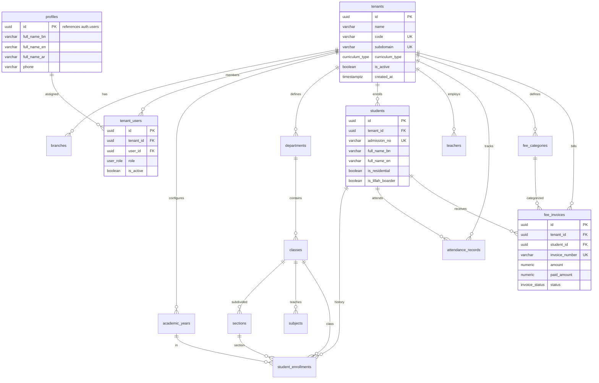

# 08. Database Architecture & Entity Relationships (ERD)

**Program**: Madrasa Digitalization Initiative (MDI)  
**Database**: PostgreSQL 17 (Supabase Managed in `ap-south-1`)  
**Status**: 15 Public Tables Live with RLS Enabled  

---

## 1. Entity-Relationship Diagram (ERD)

---

## 2. Table Specifications & Constraints

### 2.1 Core Multi-Tenancy Tables
- `tenants`: Primary institutional root. Constraints: `code UNIQUE`, `subdomain UNIQUE`, `custom_domain UNIQUE`.
- `branches`: Multi-campus structure. Constraints: `UNIQUE(tenant_id, code)`.
- `profiles`: User identity linked 1:1 with Supabase `auth.users(id)` with `ON DELETE CASCADE`.
- `tenant_users`: Join table for tenant membership and roles. Constraints: `UNIQUE(tenant_id, user_id, role)`.

### 2.2 Academic Hierarchy Tables
- `academic_years`: Calendar terms with dual Hijri and Gregorian support.
- `departments`: Divisions (e.g. Kitab, Hifz, Nurani, Alia Ebtedayee). Constraints: `UNIQUE(tenant_id, code)`.
- `classes`: Classes/Marhalas (e.g. Dawra-e-Hadith, Mishkat, Dakhil 10). Constraints: `UNIQUE(tenant_id, department_id, code)`.
- `sections`: Class branches/sections. Capacity default: 40.
- `subjects`: Kitabs/Subjects taught in a class with `total_marks` and `passing_marks`. Constraints: `UNIQUE(tenant_id, class_id, code)`.

### 2.3 Student, Staff & Operations Tables
- `students`: Central SIS entity with biographical, residential, and Lillah indicators. Constraints: `UNIQUE(tenant_id, admission_no)`.
- `student_enrollments`: Yearly class enrollments. Constraints: `UNIQUE(academic_year_id, class_id, section_id, roll_no)` and `UNIQUE(academic_year_id, student_id)`.
- `teachers`: Faculty registry with employee ID, designations, and qualifications. Constraints: `UNIQUE(tenant_id, employee_id)`.
- `attendance_records`: Attendance log. Constraints: `UNIQUE(tenant_id, student_id, attendance_date)`.
- `fee_categories`: Fee taxonomy (Tuition, Admission, Exam, Hostel).
- `fee_invoices`: Financial invoices with payment status and due dates. Constraints: `UNIQUE(tenant_id, invoice_number)`.

### 2.4 Financial & Double-Entry Ledger Tables (Phase 6 Schema)
- `accounts`: Tenant Chart of Accounts (Asset, Liability, Equity, Revenue, Expense). Constraints: `UNIQUE(tenant_id, account_code)`.
- `journal_entries`: Immutable balanced financial transactions with sequence numbers (`entry_number`). Status: `draft`, `posted`, `reversed`.
- `journal_entry_lines`: Individual debit/credit lines. Constraint: `CHECK (debit >= 0 AND credit >= 0)`.
- `lillah_fund_allocations`: Sub-ledger mapping charitable Lillah/Zakat expenditures strictly to eligible students (`is_lillah_boarder = true`).
- `audit_logs`: Append-only, tamper-evident action ledger tracking actor, action, previous state, and new state.

---

## 3. Indexing Strategy for RLS Performance
- In PostgreSQL 17 with Row Level Security, every query executes an implicit `WHERE tenant_id IN (...)` clause.
- Composite unique constraints with `tenant_id` as the **leading column** (`UNIQUE(tenant_id, code)`, `UNIQUE(tenant_id, admission_no)`) automatically provide btree indexes that accelerate RLS tenant filtering.
- 29 verified btree indexes are currently active across all 15 public tables.

