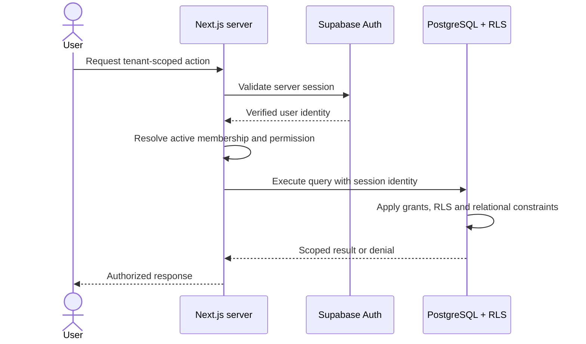

# 09. Multi-Tenancy Architecture & Data Isolation

**Model:** Shared database/shared schema with tenant-scoped PostgreSQL Row Level Security  
**Authority:** authenticated server identity plus database membership/policy checks

## 1. Tenant isolation contract

Each institution (Madrasa) is a tenant. A user may have memberships in one or more tenants, with a role scoped to each membership. Tenant identity may be selected in the UI or resolved from a domain/session context, but that selection is never authorization by itself.

Required request flow:
1. Authenticate the request using the trusted server-side session.
2. Resolve the user's active membership for the requested tenant.
3. Reject missing, inactive, ambiguous or invalid tenant context (fail closed).
4. Execute the operation using a server-side Supabase client/session.
5. Let database grants and RLS independently constrain rows.
6. Record privileged or high-impact operations in an audit trail.

## 2. RLS helper implementation

The repository includes migration `00044_private_rls_security_definer_helpers.sql`. It defines narrowly scoped helper implementations in the `private` schema using SECURITY DEFINER and a fixed search_path, then exposes public SECURITY INVOKER wrappers for compatibility with policy expressions/application calls.

The private helper logic checks `auth.uid()`, active membership, excludes the legacy `super_admin` tenant role and requires an active tenant lifecycle state. Do not copy an older public SECURITY DEFINER example into a new migration.

Before changing the helper model:
- inspect exact function owners and grants;
- confirm private schema usage/execute privileges;
- inspect wrapper grants and all call sites;
- test unauthenticated, inactive, pending-activation, multi-tenant and cross-tenant cases;
- ensure no client-controlled tenant identifier can widen access.

RLS policy changes must account for PostgreSQL permissive policies combining with OR. Removing one broad policy does not prove the effective policy surface is narrow.

## 3. Tenant-aware relationships

Use tenant-scoped unique constraints and composite foreign keys when parent and child both carry tenant identity. Where a child derives tenant identity from a parent, enforce the derivation at the database boundary. Test cross-tenant FK attempts using at least two isolated test tenants.

## 4. Platform owner separation

The Global Platform Owner is a platform-level principal, not a tenant role. Platform authorization is separate from tenant membership/RLS and must use its own trusted identity binding, MFA and narrow server-side checks. The historical `super_admin` enum value may remain for compatibility but must not be treated as an authorized current platform role.

## 5. Background work

Background jobs cannot assume that `auth.uid()` exists. Every job must:
- carry a validated tenant identifier and a bounded job type;
- use a transaction-local, trusted tenant context or a dedicated narrowly scoped worker authorization path;
- reject unscoped jobs;
- be idempotent and concurrency-safe;
- avoid cross-tenant bulk operations;
- log actor/service identity, outcome and correlation ID;
- use least-privilege worker credentials.

Do not assume a `SET LOCAL app.current_tenant_id` pattern works automatically: a corresponding policy and connection/transaction implementation must be present and tested.

## 6. Current tenant selection and domain-routing boundary

The current production workspace resolves tenant context from the authenticated user's active `tenant_users` membership and the server-issued `m_active_tenant` HttpOnly cookie.

- On sign-in, the server clears any previous tenant-selection cookie and reads only the signed-in user's active membership rows.
- A single active membership is selected automatically. Multiple memberships require the explicit `/select-tenant` flow.
- The selection cookie is a routing hint only. The server rechecks the authenticated user's membership, tenant lifecycle state and role; database grants and RLS remain authoritative.
- Logout ends the Supabase session and deletes the tenant-selection cookie.
- Never infer a tenant from the first label of an arbitrary hostname. In particular, `sahitech.dpdns.org` is the platform root host, not a Madrasa subdomain.

Subdomain/custom-domain routing remains a target capability, not a verified current production feature. Only enable it after explicit base-domain allowlisting, DNS/TLS, tenant resolution, cookie scope, auth callbacks and routing are tested for that domain. Invalid host-to-tenant mappings must fail closed.
