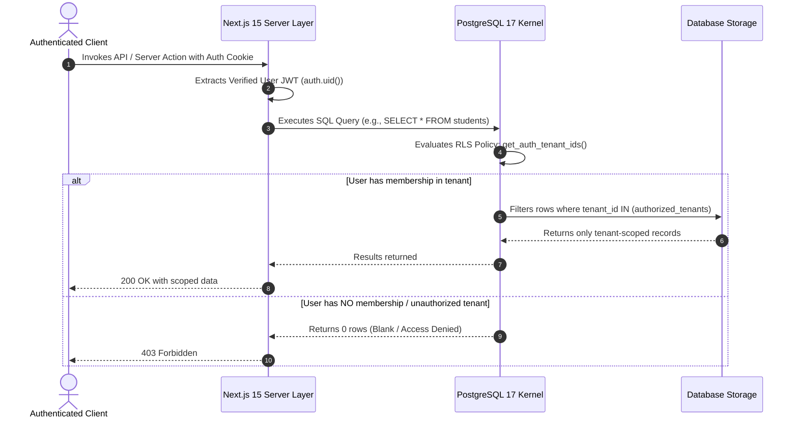

# 09. Multi-Tenancy Architecture & Data Isolation

**Program**: Madrasa Digitalization Initiative (MDI)  
**Parent Brand**: SahiTech  
**Division**: SahiTech Education  

---

## 1. Selected Tenancy Model: Shared Database + Shared Schema with PostgreSQL RLS

MDI uses **Engine-Level Row Level Security (RLS)** in PostgreSQL 17. Every operational table includes a `tenant_id` column, and PostgreSQL enforces tenant boundaries directly inside the database kernel before any data leaves the storage engine.



---

## 2. Security Definer Helper Function

To enforce high-performance, non-bypassable tenant isolation without trusting client-side headers:

```sql
CREATE OR REPLACE FUNCTION public.get_auth_tenant_ids()
RETURNS SETOF UUID
LANGUAGE sql
SECURITY DEFINER
STABLE
SET search_path = public
AS $$
    SELECT tenant_id 
    FROM public.tenant_users 
    WHERE user_id = auth.uid() 
      AND is_active = true;
$$;
```

### Architectural Defenses:
- `SECURITY DEFINER`: Runs with the privileges of the creator to securely inspect membership records in `tenant_users`.
- `SET search_path = public`: Permanently fixes the schema search path, defeating search-path injection vulnerabilities.
- `STABLE`: Enables PostgreSQL query planner to cache the result within a single transaction, optimizing bulk query performance.

---

## 3. Hostname & Custom Domain Resolution

MDI supports multiple routing options for tenants:
1. **Platform Subdomain**: `[subdomain].sahitech-edu.com` (e.g. `darululoom.sahitech-edu.com`).
2. **Custom Institutional Domain**: `[madrasa.edu.bd]` (e.g. `jamia-dhaka.edu.bd`).
3. **Session Cookie Fallback**: Used during development or direct portal access (`localhost:3000/portals/admin`).

## 4. Background Job & Asynchronous Worker Tenant Isolation

In asynchronous background processing (e.g. automated midnight fee invoice generation or bulk SMS alerts), `auth.uid()` is null. To prevent cross-tenant data pollution:
1. Every background job queue payload specifies the exact target `tenant_id`.
2. Worker execution wraps processing inside a transaction setting `SET LOCAL app.current_tenant_id = '<target_tenant_id>'`.
3. Dedicated background worker RLS policies verify that `current_setting('app.current_tenant_id', true)::uuid == tenant_id`.
4. Jobs for Tenant A cannot read, lock, or mutate records belonging to Tenant B.

---

## 5. Controlled Institutional Support Access
Platform engineers and super admins cannot view a tenant's internal records without an explicit, time-limited support grant issued by the institution's primary administrator. Support sessions are visually indicated with an un-dismissible red banner and logged in the immutable audit trail. (See [27. Institutional Support & Audit Protocol](file:///c:/Users/O%20MAMA/SahiTech-Education/docs/27_INSTITUTIONAL_SUPPORT_AND_AUDIT_PROTOCOL.md)).


