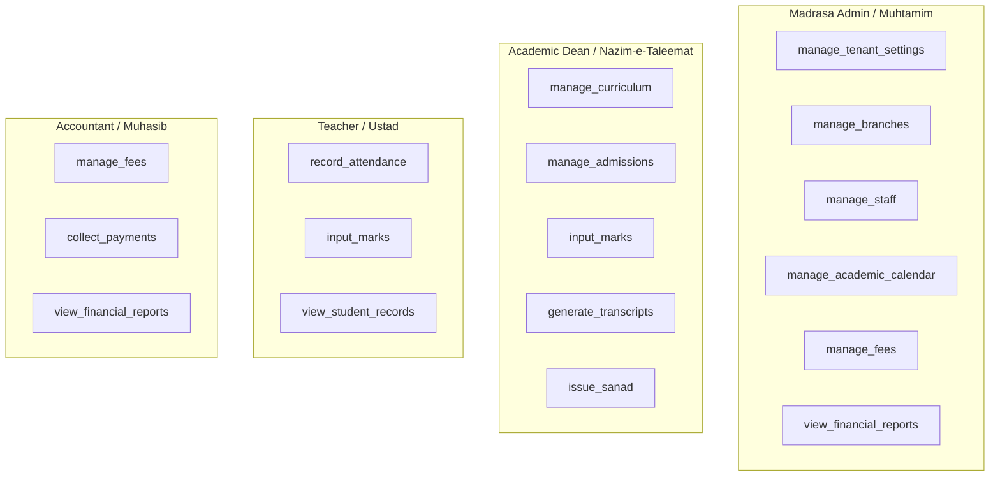

# 10. Authentication & Role-Based Access Control (RBAC)

**Program**: Madrasa Digitalization Initiative (MDI)  
**Parent Brand**: SahiTech  
**Division**: SahiTech Education  

---

## 1. Authentication Engine: Supabase Auth

MDI leverages Supabase Auth for enterprise-grade authentication:
- **Email & Password**: Standard administrative login for Muhtamim, Academic Dean, and Staff.
- **Mobile Phone & OTP**: Simplified SMS-based login for Ustads and Guardians.
- **Session Tokens**: Cryptographically signed JSON Web Tokens (JWT) stored in HTTP-only, Secure, SameSite=Lax cookies via `@supabase/ssr`.

---

## 2. Role Taxonomy & Authorization Matrix

MDI defines 7 institutional roles scoped by `tenant_id`. The Global Platform Owner is a separate platform identity and is never a tenant role:

| Role Key | Classical Designation | Primary Operational Scope |
| :--- | :--- | :--- |
| `madrasa_admin` | Muhtamim / Principal | Full administrative governance within the tenant. |
| `academic_dean` | Nazim-e-Taleemat | Curricula, routines, exam schedules, mark approvals, Sanads. |
| `teacher` | Ustad / Muallim | Class attendance entry, subject marks recording, student remarks. |
| `accountant` | Muhasib / Bursar | Fee invoicing, cash collection, voucher printing, financial reporting. |
| `hostel_warden` | Nazim-e-Darul-Iqamah | Dormitory room assignments, residential attendance, kitchen meal counts. |
| `student` | Talib-e-Ilm | Viewing personal attendance, marksheet, routine, and syllabus. |
| `parent` | Abhibhabok / Guardian | Viewing child attendance, exam report cards, and online fee payment. |

---

## 3. Global Platform Owner

The single Global Platform Owner identity is stored separately from tenant memberships. It authenticates with email/password and mandatory TOTP MFA (`aal2`). Only the bound, verified owner can review applications, issue/revoke invitations, inspect application documents, and perform final tenant activation. No tenant role has cross-tenant privileges.

The legacy database enum value `super_admin` is retained temporarily for migration compatibility but is rejected for new or updated tenant memberships, excluded from tenant RLS helper checks, and has no application permissions. Existing memberships must be audited before the enum value is removed in a later migration.

## 4. Granular Permission Matrix



### TypeScript Permission Guard Enforcement
All business logic functions verify permissions using pure TypeScript domain validators:
```typescript
import { hasPermission, UserRole, Permission } from '@sahitech/domain';

export function authorizeAction(userRole: UserRole, requiredPermission: Permission) {
  if (!hasPermission(userRole, requiredPermission)) {
    throw new Error(`Unauthorized: Role '${userRole}' lacks permission '${requiredPermission}'`);
  }
}
```
Client navigation is visually permission-filtered, but server-side execution strictly enforces the guard on every database mutation.

