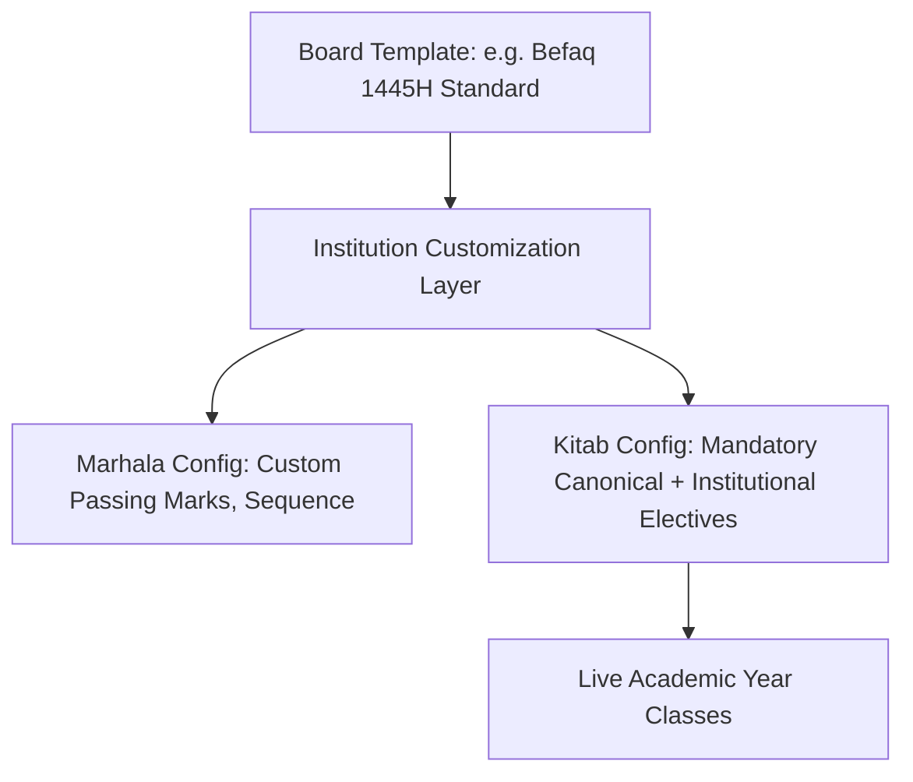
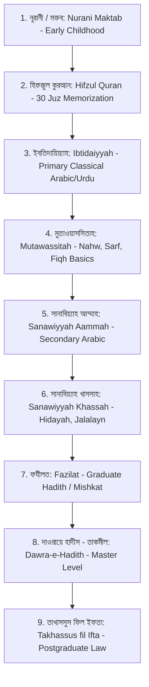

# 12. Qawmi Academic Engine Specification

**Program**: Madrasa Digitalization Initiative (MDI)  
**Curriculum**: Dars-e-Nizami / Befaqul Madarisil Arabia / Al-Haiatul Ulya  
**Package Reference**: `@sahitech/domain` -> `src/academic/qawmi.ts`  

---

## 1. Classical Marhala Hierarchy & Board Variations

While Befaqul Madarisil Arabia Bangladesh is the largest board, Qawmi madrasas in Bangladesh and South Asia operate under multiple recognized federations and independent traditions:
- **Befaqul Madarisil Arabia Bangladesh (বেফাক)**
- **Wifaqul Madarisil Qawmia (ইত্তেহাদ/গওহরডাঙ্গা)**
- **Befaqul Madarisil Diniya (দীনিয়া বোর্ড)**
- **Al-Haiatul Ulya (আল-হাইআতুল উলয়া)**: The unified national umbrella body for the Dawra-e-Hadith (Takmil) Master-equivalent central examinations.
- **Independent / Jamia Customs**: Major historic Jamias (e.g., Darul Uloom Hathazari, Jamia Islamia Patiya) maintain customized kitabs, specific elective subjects, and tailored term schedules.

### Configurable Curriculum Versioning Model
MDI does not hardcode a single monolithic curriculum. Instead, curricula are modeled as **versioned, template-driven configurations**:

### 1.1 Canonical Marhalas (Dars-e-Nizami Baseline)

### Comprehensive Marhala Matrix

| Code | Marhala Name (Bangla) | English Designation | Arabic Title | Canonical Kitabs |
| :--- | :--- | :--- | :--- | :--- |
| `NUR` | নূরানী / মক্তব | Nurani / Maktab | المكتب النوراني | কায়দা, আমপারা, নাজেরা, জরুরি মাসায়েল |
| `HFZ` | হিফজুল কুরআন | Hifzul Quran | تحفيظ القرآن الكريم | সবক (Daily), সবকি (Revision), আমোখতা (Cumulative) |
| `IBT` | মারহালাতুল ইবতিদায়িয়্যাহ | Ibtidaiyyah (Primary) | المرحلة الابتدائية | মিযান, মুনশাইব, তালীমুল ইসলাম, কারিমা |
| `MUT` | মারহালাতুল মুতাওয়াসসিতাহ | Mutawassitah (Middle) | المرحلة المتوسطة | নাহবেমীর, হেদায়াতুন্নাহব, ইলমুস সরফ, কুদূরী |
| `SNA` | সানাবিয়্যাহ আল-আম্মাহ | Sanawiyyah Aammah | المرحلة الثانوية العامة | আল-কাফিয়া, শরহে জামী, কানযুদ্দাকায়েক, নূরুল আনওয়ার |
| `SNK` | সানাবিয়্যাহ আল-খাসসাহ | Sanawiyyah Khassah | المرحلة الثانوية الخاصة | তফসীরে জালালাইন, আল-হেদায়া (আউয়ালাইন), মুখতাসারুল মাআনী |
| `FAZ` | মারহালাতুল ফযীলত | Fazilat (Mishkat) | مرحلة الفضيلة (المشكاة) | মিশকাতুল মাসাবীহ, হেদায়া (সালাইস ও রাবে), শরহুল আকাঈদ |
| `TAK` | দাওরায়ে হাদীস (তাকমীল) | Dawra-e-Hadith (Master Eqv.) | مرحلة التكميل (دورة الحديث) | সহীহুল বুখারী, সহীহ মুসলিম, তিরমিযী, আবু দাউদ, নাসাঈ, ইবনে মাজাহ |
| `IFT` | তাখাসসুস ফিল ইফতা | Takhassus fil Ifta (Postgrad) | التخصص في الإفتاء | রমজুদ্দাকায়েক, আল-আশবাহ ওয়ান-নাজায়ের, উসূলুল ইফতা |

---

## 2. Term Structure (*Chala* System)
Qawmi madrasas follow a 3-term academic year based on the Islamic Hijri calendar:
1. **১ম ছালা (1st Chala / Term)**: Shawwal to Rabi al-Awwal.
2. **২য় ছালা (2nd Chala / Term)**: Rabi al-Thani to Rajab.
3. **বার্ষিক পরীক্ষা (Annual Term)**: Sha'ban (Comprehensive examination covering the full year's texts).

---

## 3. Classical Evaluation & Grading
- **মুমতাজ (Mumtaz / Distinction)**: 80% – 100%
- **জায়্যিদ জিদ্দান (Jayyid Jiddan / 1st Division)**: 65% – 79%
- **জায়্যিদ (Jayyid / 2nd Division)**: 50% – 64%
---

## 4. Academic Progression & Graduation Rules
1. **Term Aggregate & Annual Weighting**:
   - `Final Grade = (1st Chala * 20%) + (2nd Chala * 20%) + (Annual Exam * 60%)` (Default configurable ratio).
2. **Passing Invariant**:
   - Minimum pass mark is 33% per subject by default, configurable by the institution up to 40% or 50% for advanced Hadith and Ifta tiers.
   - Failing in more than 2 core canonical kitabs requires repeating the Marhala or taking an institutional supplementary exam (*Istidrak / সম্পূরক পরীক্ষা*).
3. **Dawra-e-Hadith Central Board Registration**:
   - Students in their final year (Takmil / Dawra-e-Hadith) can have their institutional records mapped to Al-Haiatul Ulya central roll and registration numbers for national board examinations.

