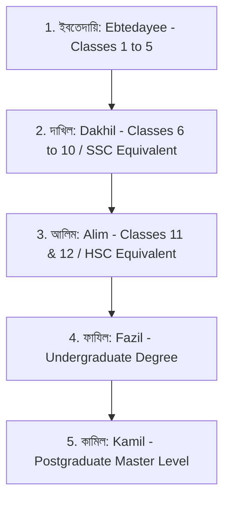
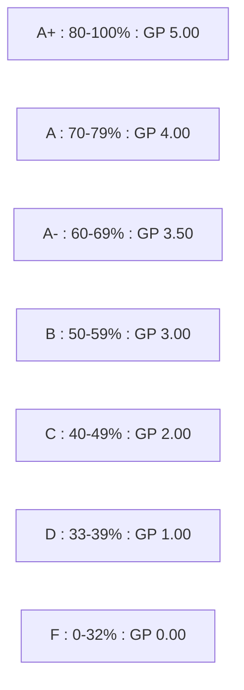

# 13. Alia Academic Engine Specification

**Program**: Madrasa Digitalization Initiative (MDI)  
**Governing Body**: Bangladesh Madrasa Education Board (BMEB) / Islamic Arabic University  
**Package Reference**: `@sahitech/domain` -> `src/academic/alia.ts`  

---

## 1. BMEB Grade Tiers

The Alia Academic Engine models the structured national curriculum recognized by the Government of Bangladesh:

### Grade Structure Matrix

| Class Code | Bengali Title | English Equivalent | Tier | BMEB Equivalent |
| :--- | :--- | :--- | :--- | :--- |
| `EBT-1` to `EBT-5` | ইবতেদায়ি ১ম – ৫ম শ্রেণি | Ebtedayee Classes 1 to 5 | Primary | Primary Education Completion |
| `DAK-6` to `DAK-8` | দাখিল ৬ষ্ঠ – ৮ম শ্রেণি | Dakhil Classes 6 to 8 | Junior Secondary | Junior Dakhil Certificate (JDC) |
| `DAK-9` & `DAK-10` | দাখিল ৯ম ও ১০ম শ্রেণি | Dakhil Classes 9 & 10 | Secondary | Dakhil Examination (SSC Eqv.) |
| `ALM-11` & `ALM-12` | আলিম ১ম ও ২য় বর্ষ | Alim 1st & 2nd Year | Higher Secondary | Alim Examination (HSC Eqv.) |
| `FAZ-DEG` | ফাযিল (পাস/অনার্স) | Fazil (Undergraduate) | Tertiary Degree | Islamic Arabic University Degree |
| `KAM-MAS` | কামিল (স্নাতকোত্তর) | Kamil (Postgraduate) | Master Equivalent | Islamic Arabic University Masters |

---

## 2. BMEB National GPA Grading Scale

### Grade Point Conversion:
- **A+ (5.00)**: 80% to 100% (Outstanding)
- **A (4.00)**: 70% to 79% (Very Good)
- **A- (3.50)**: 60% to 69% (Good)
- **B (3.00)**: 50% to 59% (Satisfactory)
- **C (2.00)**: 40% to 49% (Acceptable)
- **D (1.00)**: 33% to 39% (Passing)
- **F (0.00)**: Below 33% (Fail)

---

## 3. Board Subject & Examination Architecture
- Subjects combine religious studies (Quran Majid, Hadith Sharif, Fiqh & Usul, Arabic 1st & 2nd) with national general subjects (Bangla, English, General Mathematics, ICT, General Science).
---

## 4. Configurable Board Curricula & Syllabus Versioning
1. **National Curriculum Versions**: BMEB curricula undergo periodic revisions (e.g., General Math, ICT, and Science syllabus updates). MDI supports versioned syllabus templates (`bmeb_curriculum_2024`, `bmeb_curriculum_2026`).
2. **Institutional Electives**: Madrasas can configure institution-specific elective streams in Dakhil and Alim (Science Group, Humanities Group, Mujabbid Group).
3. **Continuous Assessment (CA) vs Exam Marks**: Support configurable weighting between continuous internal assessment (ধারাবাহিক মূল্যায়ন) and terminal written examinations.

