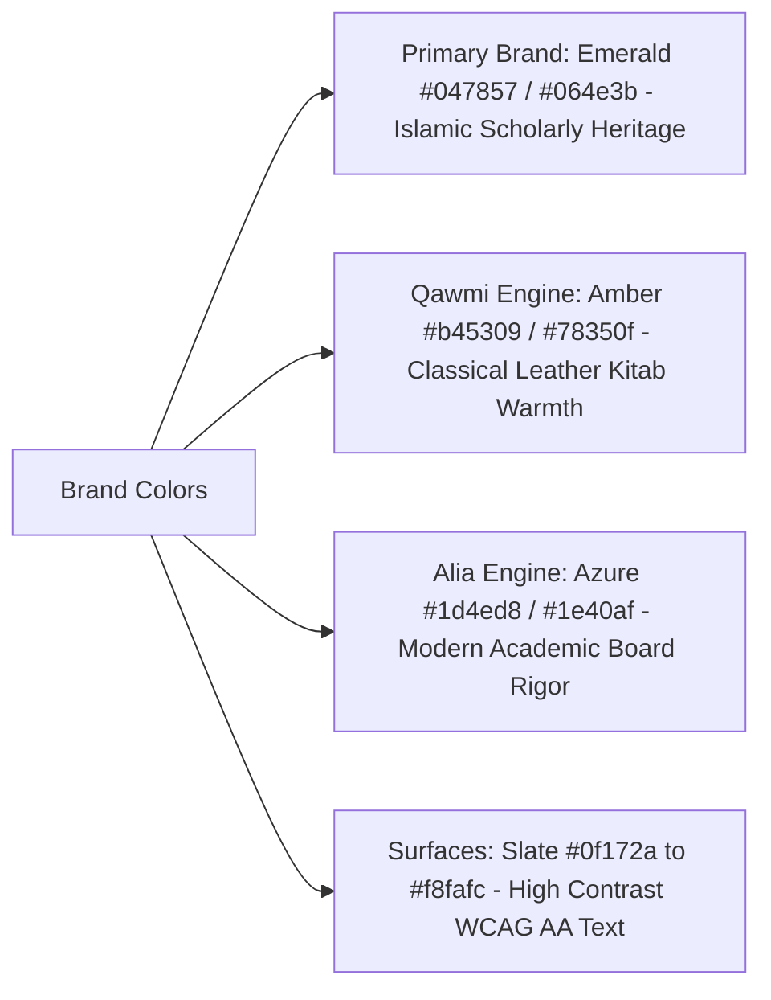

# 14. Frontend Architecture & Design System

**Program**: Madrasa Digitalization Initiative (MDI)  
**Parent Brand**: SahiTech  
**Division**: SahiTech Education  
**Framework**: Next.js 15 App Router, React 19, Tailwind CSS  

---

## 1. Visual Identity & Brand Color Tokens

MDI communicates dignity, scholarly reverence, modern clarity, and institutional trust:

### Color Token Palette:
- **`brand-700` (`#047857`)**: Primary navigation, active indicators, call-to-action buttons.
- **`brand-900` (`#064e3b`)**: Executive headers, deep contrast text on light surfaces.
- **`qawmi-600` (`#b45309`)**: Badges, kitabs, classical Marhala indicators.
- **`alia-600` (`#2563eb`)**: BMEB board grades, GPA badges, national curriculum indicators.
- **`slate-50` (`#f8fafc`)**: Background canvas.
- **`slate-900` (`#0f172a`)**: Primary typographic text.

---

## 2. Typography & Font Stack
- **Bangla (`bn`)**: Modern Unicode Bengali typography with optimized conjuncts and legible vowel signs (হ্রস্ব-ই-কার, দীর্ঘ-ঈ-কার).
- **English (`en`)**: Clean sans-serif (`Inter`, `ui-sans-serif`).
- **Arabic (`ar`)**: High-legibility classical Arabic font (`Amiri`, `Scheherazade New`).

---

## 3. UI Component Standards (shadcn/ui + Radix UI)
1. **Forms**: Built with React Hook Form and Zod validation. Input fields feature clear Bangla/English labels, helper text, and inline error states.
2. **Data Tables**:
   - Fixed left/right identity columns (Admission No, Name) on mobile viewport.
   - Truncated text with full hover tooltips.
   - Quick inline status chips (`আবাসিক`, `অনাবাসিক`, `লিল্লাহ বোর্ডিং`).
3. **Accessibility (WCAG 2.2 AA)**:
   - Full keyboard navigation with visible focus rings (`focus-visible:ring-2 focus-visible:ring-emerald-600`).
   - Semantic HTML tags (`<header>`, `<nav>`, `<main>`, `<aside>`, `<section>`, `<footer>`).
   - Explicit `aria-label` and `aria-expanded` attributes on interactive elements.

---

## 4. Shared semantic design tokens and product surfaces

The public website and authenticated application serve different jobs and may have different surface treatments. They must share semantic naming, accessibility, typography discipline, spacing consistency, and component behavior. Do not force every dashboard surface to use the public marketing palette.

### Public website
The public-site design contract and palette are defined in [28 — Public Website Islamic Design Specification](./28_PUBLIC_WEBSITE_ISLAMIC_DESIGN_SPEC.md). Its emerald/ivory/antique-gold direction is reserved for public marketing and institutional storytelling.

### Authenticated application
Use semantic tokens for application surfaces (background, surface, elevated surface, text, muted text, border, primary action, destructive action, focus ring, success, warning, and error). Curriculum identity may use restrained Qawmi amber and Alia blue accents, but status must also include text/icon—not color alone.

### Token rules
- Define tokens centrally in CSS/theme configuration and consume them through shared components.
- Do not duplicate raw hex values throughout route-level JSX.
- Maintain light/dark mode only where both themes have complete contrast and state coverage; do not expose an unfinished theme toggle.
- Prefer CSS logical properties and direction-aware components over hardcoded left/right spacing.
- Document token changes here and in the public design contract when public-facing tokens change.

## 5. Responsive interaction and accessibility contract
- Verify narrow widths from 320 px; target 44×44 px touch areas for primary touch controls.
- Use semantic navigation, forms, buttons, tables, headings, and landmarks.
- Every control must support keyboard operation and visible focus; do not rely on hover.
- Define loading, empty, error, disabled, success, and permission-denied states.
- Tables must remain usable on mobile through responsive columns, labelled local horizontal scrolling, or a deliberate card presentation—never force page-wide horizontal overflow.
- Use `prefers-reduced-motion`; animations must be subtle and non-essential.
- Follow WCAG 2.2 AA as a test target, not as a claim until audited.

## 6. Performance and maintainability
- Prefer React Server Components for read-only content; use Client Components only for required interactivity.
- Keep client bundles, icon imports, font subsets, and third-party scripts small.
- Use optimized images with explicit dimensions/aspect ratios; prioritize the actual LCP element and lazy-load non-critical media.
- Avoid duplicate fetches, unnecessary re-renders, unbounded client-side lists, and sequential requests that can safely be parallelized.
- Use pagination/filtering for growing datasets and loading boundaries for slow data dependencies.
- Track Core Web Vitals (LCP ≤ 2.5 s, INP ≤ 200 ms, CLS ≤ 0.1 at p75) as targets; measure on preview/production-like builds before reporting results.

## 7. Localization and RTL implementation
See [15 — Localization & RTL](./15_LOCALIZATION_AND_RTL.md). Use locale dictionaries for all user-facing strings, locale-aware formatting, semantic direction, and CSS logical properties. Verify Bangla shaping and Arabic mixed-direction content on real responsive layouts.

## 8. Documentation ownership
Changes to shared components, tokens, typography, responsive patterns, accessibility, or frontend performance must update this document. Public homepage-specific changes must also update [28 — Public Website Islamic Design Specification](./28_PUBLIC_WEBSITE_ISLAMIC_DESIGN_SPEC.md).