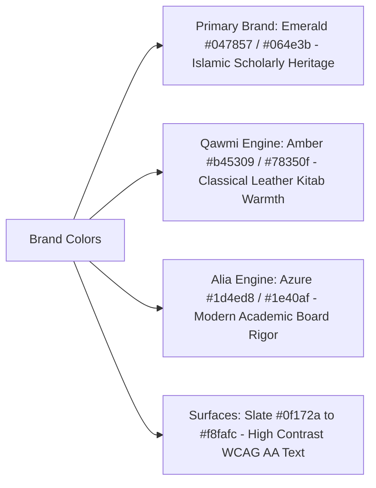

# 14. Frontend Architecture & Design System

**Program**: Madrasa Digitalization Initiative (MDI)  
**Parent Brand**: SahiTech  
**Division**: SahiTech Education  
**Framework**: Next.js 15 App Router, React 19, Tailwind CSS  

---

## 1. Visual Identity & Brand Color Tokens

MDI communicates dignity, scholarly reverence, modern clarity, and institutional trust:

### Color Token Palette:
- **`brand-700` (`#047857`)**: Primary navigation, active indicators, call-to-action buttons.
- **`brand-900` (`#064e3b`)**: Executive headers, deep contrast text on light surfaces.
- **`qawmi-600` (`#b45309`)**: Badges, kitabs, classical Marhala indicators.
- **`alia-600` (`#2563eb`)**: BMEB board grades, GPA badges, national curriculum indicators.
- **`slate-50` (`#f8fafc`)**: Background canvas.
- **`slate-900` (`#0f172a`)**: Primary typographic text.

---

## 2. Typography & Font Stack
- **Bangla (`bn`)**: Modern Unicode Bengali typography with optimized conjuncts and legible vowel signs (হ্রস্ব-ই-কার, দীর্ঘ-ঈ-কার).
- **English (`en`)**: Clean sans-serif (`Inter`, `ui-sans-serif`).
- **Arabic (`ar`)**: High-legibility classical Arabic font (`Amiri`, `Scheherazade New`).

---

## 3. UI Component Standards (shadcn/ui + Radix UI)
1. **Forms**: Built with React Hook Form and Zod validation. Input fields feature clear Bangla/English labels, helper text, and inline error states.
2. **Data Tables**:
   - Fixed left/right identity columns (Admission No, Name) on mobile viewport.
   - Truncated text with full hover tooltips.
   - Quick inline status chips (`আবাসিক`, `অনাবাসিক`, `লিল্লাহ বোর্ডিং`).
3. **Accessibility (WCAG 2.2 AA)**:
   - Full keyboard navigation with visible focus rings (`focus-visible:ring-2 focus-visible:ring-emerald-600`).
   - Semantic HTML tags (`<header>`, `<nav>`, `<main>`, `<aside>`, `<section>`, `<footer>`).
   - Explicit `aria-label` and `aria-expanded` attributes on interactive elements.

