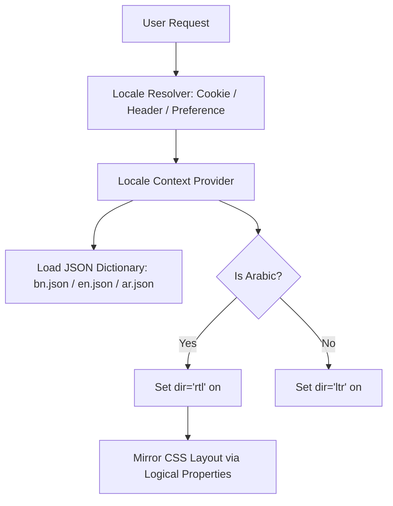

# 15. Localization & RTL (Right-to-Left) Architecture

**Program**: Madrasa Digitalization Initiative (MDI)  
**Parent Brand**: SahiTech  
**Division**: SahiTech Education  
**Supported Locales**: `bn` (Bangla - Default), `en` (English), `ar` (Arabic)  

---

## 1. Trilingual Architecture Overview



---

## 2. Deep RTL Layout Mirroring Standards

In Arabic (`ar`), the entire user interface mirrors horizontally:
1. **Sidebars**: Shift from left to right (`start-0` resolves to right side).
2. **Icons**: Directional icons mirror (e.g. `ChevronRight` becomes `ChevronLeft` when navigating forward).
3. **Tables**: Columns read from right to left (First column: Student Name, Last column: Actions on the far left).

### CSS Logical Properties Implementation:
Zero legacy directional properties (`margin-left`, `margin-right`, `left`, `right`) are permitted in codebase CSS. All components must use CSS logical properties:
```html
<!-- Correct: Responsive to both LTR and RTL -->
<div className="ms-4 me-2 ps-3 pe-6 start-0">
  <span className="text-start">...</span>
</div>

<!-- FORBIDDEN: Breaks Arabic RTL layout -->
<div className="ml-4 mr-2 pl-3 pr-6 left-0">
  <span className="text-left">...</span>
</div>
```

---

## 3. Bidirectional (BiDi) Text Isolation
When rendering mixed Arabic text (e.g., Quranic ayahs, Hadith references, or kitab titles like *صحيح البخاري*) within Bengali or English prose, wrap the string in `<bdi>` (bidirectional isolate) to avoid punctuation inversion:
```jsx
<p>
  আজকের পাঠ্য কিতাব: <bdi dir="rtl" className="font-serif text-emerald-800">صحيح البخاري</bdi> (প্রথম খণ্ড)।
</p>
```

