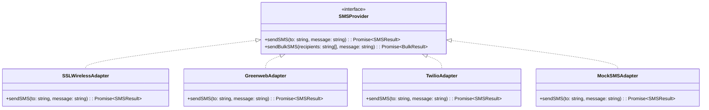

# 16. API & Integration Standards

**Program**: Madrasa Digitalization Initiative (MDI)  
**Parent Brand**: SahiTech  
**Division**: SahiTech Education  

---

## 1. Adapter Pattern for External Services

MDI isolates all third-party dependencies behind clean TypeScript interfaces. The core application logic never directly invokes vendor-specific SDKs.



---

## 2. Payment Gateway Adapter Framework

```typescript
export interface PaymentGatewayAdapter {
  initiatePayment(params: {
    invoiceId: string;
    amount: number;
    currency: string;
    callbackUrl: string;
  }): Promise<{ paymentUrl: string; transactionReference: string }>;

  verifyPayment(payload: Record<string, unknown>): Promise<{
    isSuccessful: boolean;
    transactionId: string;
    paidAmount: number;
  }>;
}
```

### Supported Provider Implementations:
1. **bKash PGW (Direct API)**: Primary MFS channel in Bangladesh.
2. **Nagad Gateway**: Secondary MFS channel in Bangladesh.
3. **SSLCommerz**: Aggregator for Visa/Mastercard, internet banking, and mobile wallets.
4. **Stripe (Future)**: International card processing for overseas branches or donors.
5. **MockPaymentGateway**: Local sandbox development adapter.

---

## 3. Webhook Handling & Idempotency Standard
1. **Idempotency Key**: All financial webhook handlers enforce idempotency by recording incoming gateway `transaction_id` in `payment_transactions(gateway_tx_id) UNIQUE`.
2. **Signature Verification**: Webhooks verify HMAC-SHA256 request signatures before body parsing.
3. **Replay Protection**: Webhooks with timestamps older than 5 minutes are rejected.

