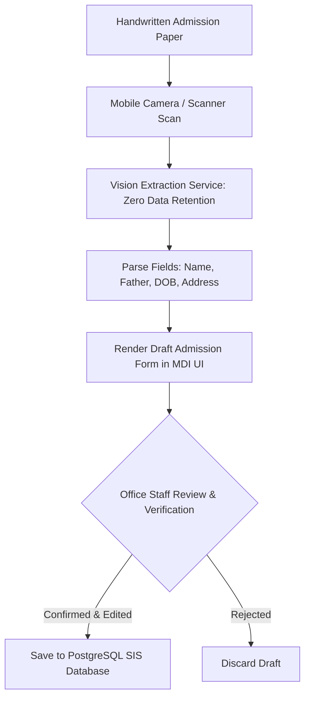

# 17. AI & Automation Architecture (Privacy-First)

**Program**: Madrasa Digitalization Initiative (MDI)  
**Parent Brand**: SahiTech  
**Division**: SahiTech Education  

---

## 1. Architectural Philosophy: Assistant, Not Authority

AI within MDI operates strictly as a **productivity assistant** for human administrators, never as an autonomous authority:
- **Zero Autonomous Destructive Actions**: AI cannot alter grades, delete student records, or issue financial adjustments without human sign-off.
- **Zero-Retention Privacy**: No student personal data, photos, or exam records are stored or used for training third-party models.
- **Human-in-the-Loop**: Every AI extraction or generated draft requires explicit human review and confirmation.

---

## 2. Core High-Value AI Capabilities

### 2.1 Bengali Handwritten Form OCR
- **Context**: In rural Bangladesh, guardians submit handwritten admission forms in Bengali script.
- **Function**: Extracts key fields (Student Name in Bengali, Father's Name, Date of Birth, Guardian Phone, Present Address) into structured JSON drafts.
- **Result**: Reduces student enrollment data entry from 5 minutes to 45 seconds per student.

### 2.2 Trilingual Notice & Announcement Drafter
- **Context**: Madrasas need to publish notices (Ramadan closures, exam dates, fee deadlines) in formal administrative Bengali, classical Arabic, and English.
- **Function**: Takes brief bullet points from the Muhtamim and drafts polished, respectful, grammatically correct notices in all three languages.

### 2.3 Attendance Anomaly Early-Warning Detector
- **Context**: Residential madrasa students who fall ill or experience distress often show early attendance anomalies.
- **Function**: Detects patterns (e.g., student missing two consecutive morning Fajr roll calls or sudden drops in dining hall meals) and alerts the Hostel Warden.

