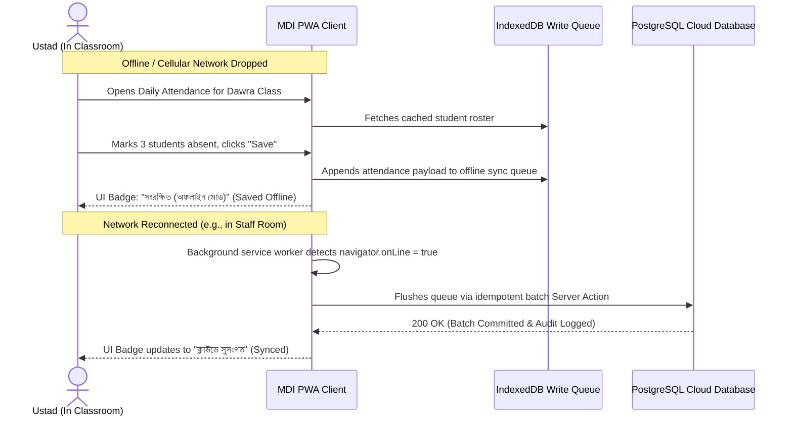

# 18. Mobile & Offline-First Architecture

**Program**: Madrasa Digitalization Initiative (MDI)  
**Parent Brand**: SahiTech  
**Division**: SahiTech Education  

---

## 1. Progressive Web App (PWA) Foundation

Recognizing that classroom teachers in rural brick-and-mortar campuses often encounter weak or zero cellular reception, MDI implements a **Progressive Web App (PWA)** offline architecture:

---

## 2. Offline-Safe Workflows vs Cloud-Mandatory Workflows

| Operational Domain | Offline Capability | Storage Mechanism | Conflict Resolution Standard |
| :--- | :--- | :--- | :--- |
| **Daily Attendance** | **100% Offline Capable** | Local IndexedDB | Idempotent client-generated batch UUID (`batch_id`). Last write wins for daily date. |
| **Exam Marks Entry Drafts** | **Offline Draft Capable** | Local IndexedDB | Drafts saved locally; formal submission and snapshot calculation require cloud sync. |
| **Student Directory Lookup** | **Read-Only Offline** | Service Worker Cache | Cached active student roster for the assigned class/marhala. |
| **Fee Collection & Cash** | **Cloud-Only (Online Required)**| None (Disabled offline) | Cash receipts create financial liability; strictly forbidden without verified server sequence number. |
| **Sanad & Certificate Issuance**| **Cloud-Only (Online Required)**| None (Disabled offline) | Cryptographic signature requires server-side private key verification. |

---

## 3. Conflict Handling & Idempotency Rules
1. **Client UUIDs**: Every offline-created attendance row assigns a `client_uuid = crypto.randomUUID()`.
2. **Deduplication**: When syncing to PostgreSQL, `ON CONFLICT (tenant_id, student_id, attendance_date) DO UPDATE` ensures no duplicate records are generated if retries occur.

