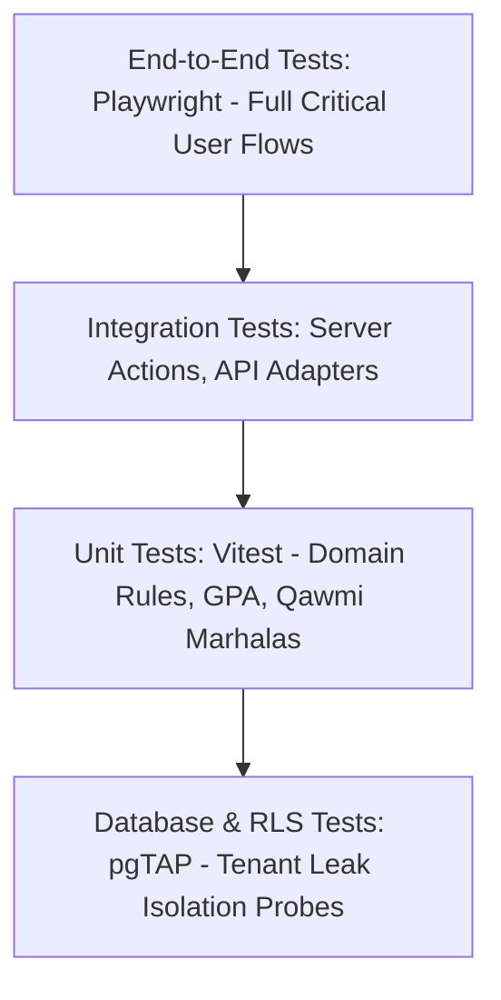

# 19. Testing & Quality Assurance Strategy

**Program**: Madrasa Digitalization Initiative (MDI)  
**Parent Brand**: SahiTech  
**Division**: SahiTech Education  

---

## 1. Multi-Tier Test Pyramid



### Testing Toolchain:
- **Unit Testing**: Vitest (instant execution, zero mock leakage, strict TypeScript coverage).
- **End-to-End (E2E)**: Playwright (cross-browser desktop & mobile viewport testing).
- **Database Security Testing**: pgTAP / Supabase CLI test runners (asserting RLS denial across tenants).

---

## 2. Automated Cross-Tenant Security Probe Suite

The most critical test in MDI is verifying that **Tenant A cannot see or mutate Tenant B's data**:

```typescript
// Example: Cross-Tenant Isolation Test Spec
describe('Multi-Tenant Isolation Assurance', () => {
  it('prevents Tenant A user from querying Tenant B student records', async () => {
    const tenantAClient = createTestClientForUser(USER_TENANT_A);
    const { data, error } = await tenantAClient
      .from('students')
      .select('*')
      .eq('tenant_id', TENANT_B_ID);

    expect(data).toHaveLength(0); // Guaranteed 0 rows returned by RLS
  });

  it('rejects cross-tenant student enrollment mutation', async () => {
    const tenantAClient = createTestClientForUser(USER_TENANT_A);
    const { error } = await tenantAClient
      .from('students')
      .insert({
        tenant_id: TENANT_B_ID,
        admission_no: 'HACK-001',
        full_name_en: 'Unauthorized Insert'
      });

    expect(error).toBeDefined(); // RLS default-deny triggers policy violation
  });
});
```

---

## 3. Quality Gates for Release
A pull request or deployment is barred from merging unless:
1. `pnpm lint` passes with 0 warnings.
2. `tsc --noEmit` passes with 0 errors across all monorepo packages.
3. 100% of domain unit tests pass.
4. RLS security isolation tests pass.
5. `next build` compiles with 0 production errors.

