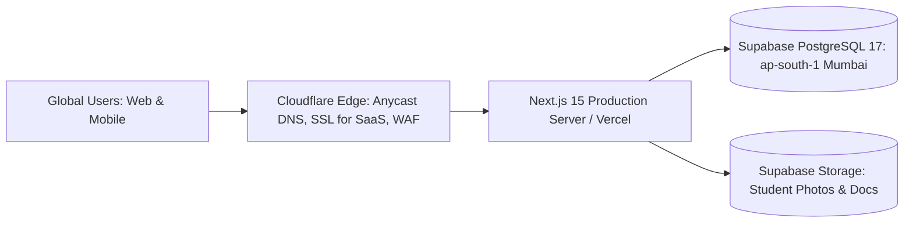

# 21. Deployment, Monitoring & Disaster Recovery

**Program**: Madrasa Digitalization Initiative (MDI)  
**Parent Brand**: SahiTech  
**Division**: SahiTech Education  

---

## 1. Cloud Infrastructure Architecture

### Production Infrastructure Topology:
- **Application Runtime**: Next.js 15 App Router deployed to low-latency serverless edge nodes or containerized Node.js.
- **Database Engine**: Managed Supabase PostgreSQL 17 in `ap-south-1` (Mumbai), providing sub-40ms round-trip latency to users in Dhaka, Chittagong, and Sylhet.
- **Custom Domain SSL**: Cloudflare for SaaS automatically provisions and renews TLS certificates for custom madrasa domains (`madrasa.edu.bd`).

---

## 2. Observability & Monitoring
1. **Health Checks**: `/api/health` probe verifying database connectivity, storage reachability, and memory utilization.
2. **Structured Logging**: JSON structured log streams containing request ID, tenant ID, user role, latency, and status code.
3. **Sensitive Data Redaction**: Passwords, guardian NID numbers, credit card details, and auth tokens are scrubbed from log outputs via regex filters.

---

## 3. Disaster Recovery & Backup Protocol

| Metric | Target Standard | Operational Strategy |
| :--- | :--- | :--- |
| **Recovery Point Objective (RPO)** | **< 1 Hour** | Continuous WAL (Write-Ahead Log) archiving + daily automated full physical snapshot at 03:00 UTC. |
| **Recovery Time Objective (RTO)** | **< 4 Hours** | Point-in-time recovery (PITR) to standby PostgreSQL replica or automated restore from S3 backup bucket. |

### Backup Restoration Drill:
Bi-annual scheduled disaster recovery drill restoring database snapshots to a staging environment and executing test test suites to verify relational integrity.

