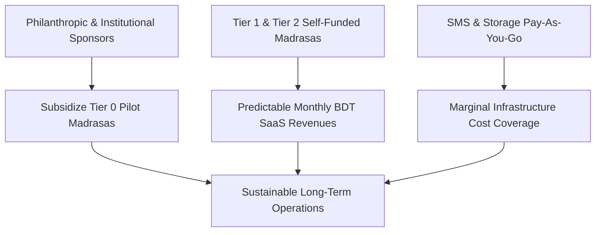

# 22. Business Model & Financial Sustainability

**Program**: Madrasa Digitalization Initiative (MDI)  
**Parent Brand**: SahiTech  
**Division**: SahiTech Education  

---

## 1. Ethically Sustainable SaaS Strategy

MDI balances philanthropic community empowerment with long-term technological self-sustainability:

---

## 2. Pricing & Entitlement Tiers

### 2.1 Tier 0: Pilot & Sponsored Free Tier
- **Target**: 3 to 5 pilot institutions and qualifying underprivileged madrasas.
- **Cost**: 100% Free (sponsored by SahiTech Education).
- **Entitlements**: Up to 300 students, 1 campus branch, full Qawmi/Alia academic engines, attendance, gradebook, and standard report cards.

### 2.2 Tier 1: Standard Institutional Plan
- **Target**: Autonomous single-campus institutions.
- **Billing**: Affordable annual subscription (e.g. ৳1,500 – ৳3,000 / month, billed annually).
- **Entitlements**: Unlimited students, full financial accounting & fee collection, institutional website CMS, guardian SMS notifications, and certificate issuance.

### 2.3 Tier 2: Multi-Branch Jamia Network
- **Target**: Large networks and historic Jamias with affiliate branches.
- **Billing**: Enterprise tier based on branch count.
- **Entitlements**: Multi-branch consolidated accounting, custom domain SSL (`jamia.edu.bd`), priority technical support, and data export APIs.

---

## 3. Usage Add-ons
- **Transactional SMS Bundles**: ৳0.35 – ৳0.45 per SMS (purchased in blocks of 5,000).
- **Extended Document Storage**: ৳500 / 10 GB per year for large photo/video galleries.
- **Custom Calligraphy & Sanad Layouts**: Bespoke ceremonial certificate design.

