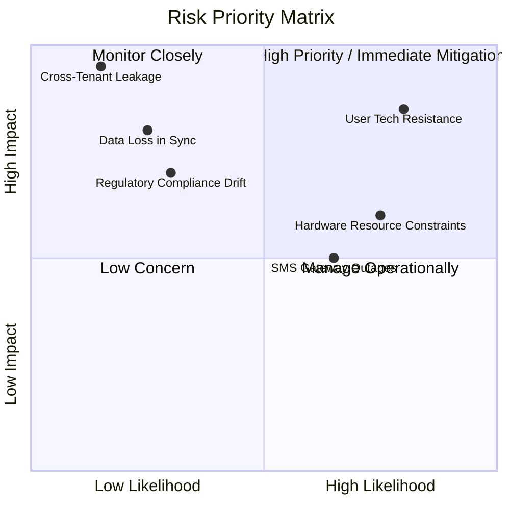

# 24. Risk Register & Mitigations

**Program**: Madrasa Digitalization Initiative (MDI)  
**Parent Brand**: SahiTech  
**Division**: SahiTech Education  

---

## 1. Risk Evaluation Matrix

---

## 2. Risk Mitigation Register

| Risk Identifier | Category | Likelihood | Impact | Mitigation Strategy |
| :--- | :--- | :--- | :--- | :--- |
| **RSK-01: User Resistance & Digital Hesitancy** | Human / Cultural | High | High | Design intuitive, colloquial Bengali interfaces mirroring traditional paper logbooks. Provide visual zero-jargon onboarding guides and video walkthroughs. |
| **RSK-02: Cross-Tenant Data Leakage** | Technical / Security | Low | Critical | Kernel-level PostgreSQL 17 Row Level Security (RLS) on all public tables with automated CI/CD test probes executing malicious cross-tenant queries on every pull request. |
| **RSK-03: Data Loss During Classroom Offline Sync** | Technical / Data | Low | High | Idempotent transaction queues in IndexedDB with client-generated UUIDs. Data is never purged from local storage until an explicit server commit acknowledgement (ACK) is received. |
| **RSK-04: SMS Gateway Outages in Bangladesh** | Operational / External | Medium | Medium | Universal notification adapter framework with automated failover (SSLWireless -> Greenweb -> In-app/Push). |
| **RSK-05: Retroactive Grade Alteration Discrepancies** | Academic / Trust | Low | High | Term results are frozen into immutable signed JSONB snapshots with SHA-256 verification hashes upon academic dean ratification. |
| **RSK-06: Shariah Non-Compliance in Charitable Funds** | Legal / Religious | Low | High | Strict dual-ledger accounting where Lillah and Zakat funds are credit-locked and cannot be disbursed for general commercial or administrative expenses. |
| **RSK-07: Low-End Smartphone Rendering Latency** | Performance | High | Medium | Zero heavy client-side libraries. Ultra-lean JS bundle (<115 kB gzipped), server-rendered HTML, and CSS logical properties. |

