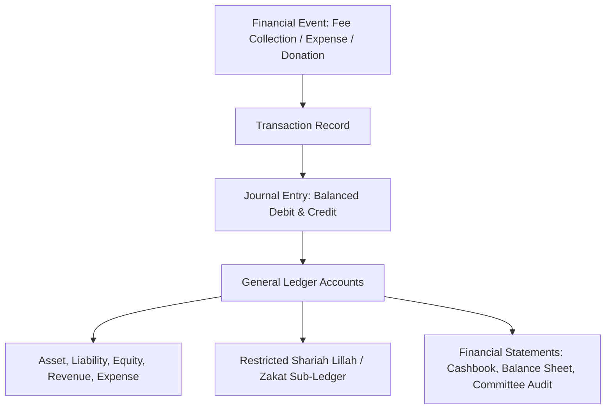
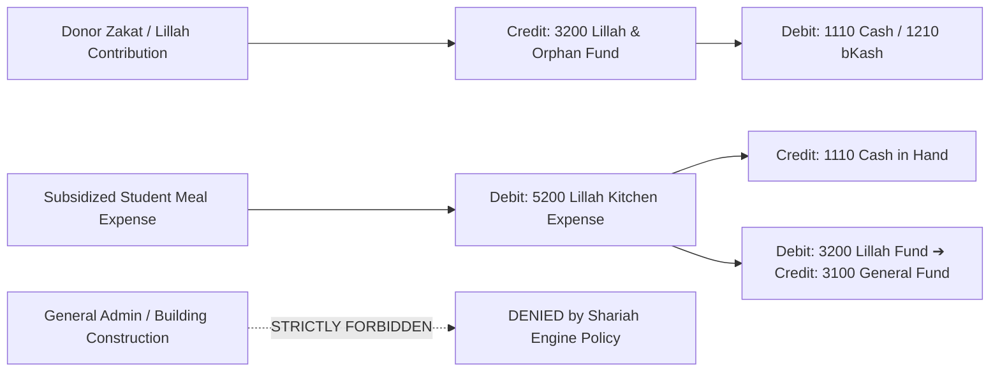
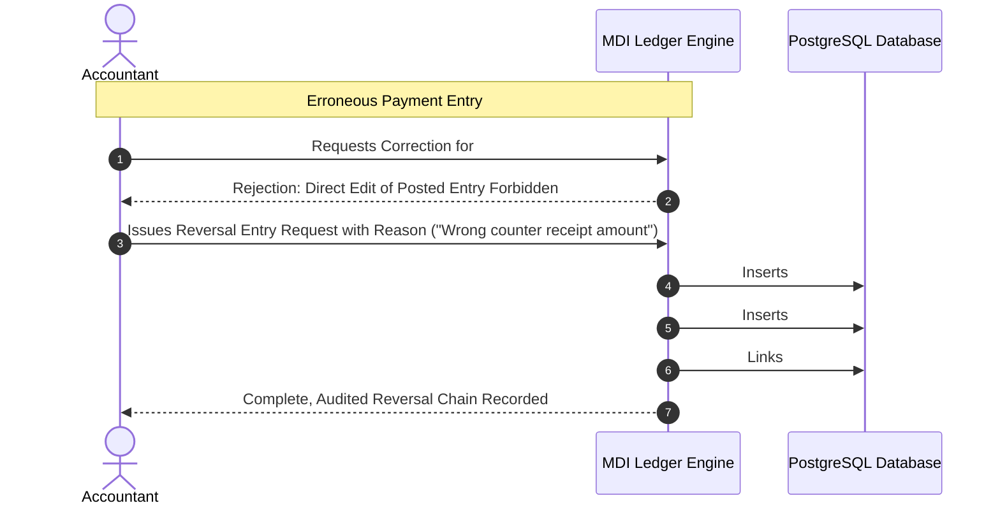

# 26. Financial & Double-Entry Accounting Specification

**Program**: Madrasa Digitalization Initiative (MDI)  
**Parent Brand**: SahiTech  
**Division**: SahiTech Education  
**Standard**: GAAP / IFRS-Compatible Double-Entry Ledger with Shariah-Compliant Fund Segregation  

---

## 1. Architectural Philosophy: Double-Entry Core

MDI does not treat institutional finance as simple disconnected payment slips. Every financial event generates balanced, immutable double-entry journal records.



---

## 2. Standard Chart of Accounts (COA) Structure

Each tenant (Madrasa) is provisioned with a standardized, customizable Chart of Accounts:

```
1000 - ASSETS (সম্পদ)
  ├── 1100: Cash and Cash Equivalents (নগদ তহবিল)
  │     ├── 1110: Cash in Hand - Main Counter (প্রধান ক্যাশ)
  │     ├── 1120: Petty Cash - Principal/Muhtamim (খুচরা ক্যাশ)
  │     └── 1130: Bank Accounts (ব্যাংক হিসাব)
  ├── 1200: Digital & MFS Wallets (ডিজিটাল ওয়ালেট)
  │     ├── 1210: bKash Merchant Wallet (বিকাশ)
  │     ├── 1220: Nagad Merchant Wallet (নগদ)
  │     └── 1230: Rocket / Bank Gateway (রকেট/ব্যাংক গেটওয়ে)
  └── 1300: Accounts Receivable (প্রাপ্য ফি ও বকেয়া)

2000 - LIABILITIES (দায়)
  ├── 2100: Accounts Payable (প্রদেয় খরচ)
  └── 2200: Advance Student Fees (অগ্রিম ফি গ্রহণ)

3000 - RESTRICTED & COMMITTED FUNDS (সংরক্ষিত ও ধর্মীয় তহবিল)
  ├── 3100: General Institutional Fund (সাধারণ প্রাতিষ্ঠানিক তহবিল)
  ├── 3200: Lillah Boarding & Orphan Subsidy Fund (লিল্লাহ বোর্ডিং ও এতিম তহবিল - Zakat/Sadqah)
  ├── 3300: Mosque & Infrastructure Waqf Fund (মসজিদ ও ভবন ওয়াকফ তহবিল)
  └── 3400: Kitab / Library Endowment Fund (কিতাব ও কুতুবখানা তহবিল)

4000 - REVENUES (আয়)
  ├── 4100: Operational Student Revenues (ছাত্র বেতন ও ফি)
  │     ├── 4110: Monthly Tuition Fees (মাসিক বেতন)
  │     ├── 4120: Annual Admission & Re-enrollment Fees (ভর্তি ও দাখেলা ফি)
  │     ├── 4130: Examination Fees (পরীক্ষা ফি)
  │     └── 4140: Residential & Hostel Utility Fees (আবাসিক ও ইউটিলিটি ফি)
  └── 4200: Charitable & Community Donations (দান ও সাহায্য)
        ├── 4210: General Public Donations (সাধারণ দান)
        ├── 4220: Zakat & Fitrah Collections (যাকাত ও ফিতরা)
        └── 4230: Animal Hide / Qurbani Skin Collections (কোরবানির চামড়া বিক্রয় আয়)

5000 - EXPENSES (ব্যয়)
  ├── 5100: Faculty & Staff Compensation (আসতিযা ও স্টাফদের বেতন-ভাতা)
  ├── 5200: Lillah Kitchen & Student Subsistence (লিল্লাহ খানা ও খাদ্য ব্যয়)
  ├── 5300: Academic & Examination Printing (পরীক্ষা ও কিতাব মুদ্রণ খরচ)
  └── 5400: Campus Utilities, Electricity & Maintenance (বিদ্যুৎ ও মেরামত ব্যয়)
```

---

## 3. Shariah-Compliant Fund Segregation (Lillah / Zakat Invariant)

### Shariah Invariant Rule:
> **Zakat, Fitrah, and Lillah funds are religious trusts (Amanah). They can strictly only be used for the direct benefit of eligible underprivileged, poor, or orphan students (*Masarif al-Zakat*). They CANNOT be commingled with general commercial revenues or used to pay general administrative overhead, construction, or commercial teacher bonuses.**



### Technical Enforcement:
1. Every payment voucher tagged with `fund_id = 'lillah_fund'` verifies against student eligibility records (`students.is_lillah_boarder = true`).
2. General operational expenses (e.g., campus rent, generator fuel) cannot reference account `3200` as a debit source. Any attempt throws an unhandled domain exception.

---

## 4. Immutability & Reversal Entries (Zero Silent Edits)

Financial integrity requires that **posted journal entries are never updated or deleted**:



---

## 5. Cash Counterfoil & Bank Reconciliation
1. **Counterfoil Slips**: Every cash payment prints a dual-leaf or tri-leaf voucher (Student Copy, Office Copy, Accounts Copy) with an auto-incrementing sequential receipt number (`receipt_sequence_no`) unique to each financial year.
2. **Reconciliation Queue**: Digital payments via bKash/Nagad are matched against the gateway transaction report. Unmatched payments are placed in an exception queue for manual bursar reconciliation.

