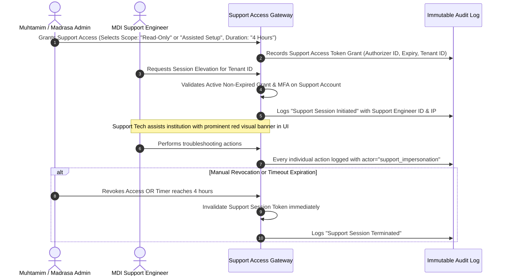
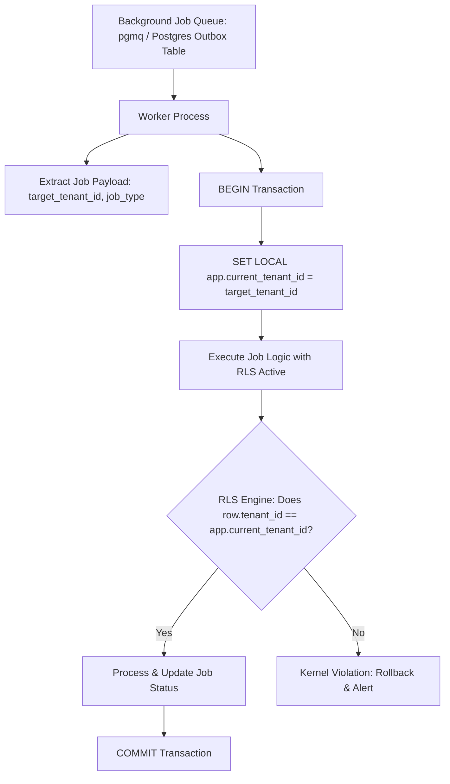

# 27. Institutional Support, Audit & Background Job Protocol

**Program**: Madrasa Digitalization Initiative (MDI)  
**Parent Brand**: SahiTech  
**Division**: SahiTech Education  
**Standards**: Zero-Trust Tenant Isolation, Audited Support Access, Safe Background Processing  

---

## 1. Controlled Support Access & Impersonation Protocol

In a multi-tenant education SaaS, platform support engineers must never have unrestrained, back-door access to an institution's confidential records, student files, or financial balances.



### Mandatory Support Access Rules:
1. **Consent Required**: Platform Super Admins **cannot** arbitrarily view tenant data without an active, explicit consent grant from the institution's primary administrator.
2. **Time-Bound**: Grants auto-expire after a maximum of 4 to 24 hours. No standing access permitted.
3. **Prominent UI Banner**: When an impersonated or support session is active, a persistent, un-dismissible high-visibility banner displays: *"Support Assistance Session Active — Authorized by Muhtamim. Actions are audited."*
4. **Zero Financial Mutation via Support**: Support access tokens are strictly barred from executing payments, transferring ledger funds, or changing bank account details.

---

## 2. Background Job Security & Tenant Isolation Protocol

In interactive HTTP requests, `auth.uid()` drives PostgreSQL Row Level Security (RLS) via `public.get_auth_tenant_ids()`. However, automated background workers (e.g. generating monthly fee invoices, sending batch SMS notifications, compiling daily attendance analytics) execute asynchronously without an active user session.



### Technical Enforcement:
1. **Tenant-Scoped Transactions**: Background workers **must never** execute unbounded cross-tenant bulk updates in a single query.
2. **Transaction Local Context**: The worker sets a transaction-local session variable:
   ```sql
   SET LOCAL app.current_tenant_id = 'c4b8...';
   ```
3. **Worker RLS Policy**: Tables include worker-specific RLS policies that verify `app.current_tenant_id`:
   ```sql
   CREATE POLICY "Worker tenant policy"
   ON public.fee_invoices FOR ALL
   USING (
     (current_setting('app.current_tenant_id', true))::uuid = tenant_id
   );
   ```
4. **Failure Isolation**: An error or deadlock in Tenant A's background job rolls back Tenant A's transaction without impacting Tenant B's queued jobs.

---

## 3. Tamper-Evident Audit Logging Protocol

All high-impact institutional operations are recorded in an append-only, tamper-evident audit ledger:

```sql
CREATE TABLE IF NOT EXISTS public.audit_logs (
    id UUID PRIMARY KEY DEFAULT gen_random_uuid(),
    tenant_id UUID NOT NULL REFERENCES public.tenants(id) ON DELETE CASCADE,
    actor_id UUID REFERENCES public.profiles(id) ON DELETE SET NULL,
    actor_role VARCHAR(50) NOT NULL,
    is_support_impersonation BOOLEAN NOT NULL DEFAULT false,
    action VARCHAR(100) NOT NULL, -- e.g., 'student.admission_approved', 'invoice.reversed'
    entity_name VARCHAR(100) NOT NULL, -- e.g., 'students', 'fee_invoices'
    entity_id UUID NOT NULL,
    previous_state JSONB,
    new_state JSONB,
    ip_address INET,
    user_agent TEXT,
    created_at TIMESTAMPTZ NOT NULL DEFAULT timezone('utc'::text, now())
);
```

### Immutable Security Constraints:
- `audit_logs` has **zero** `UPDATE` or `DELETE` permissions granted to any role.
- Triggers record the exact `previous_state` and `new_state` for exam result updates, fee reversals, and role promotions.
- Any attempt to truncate or delete audit records raises an uncatchable database alert.

