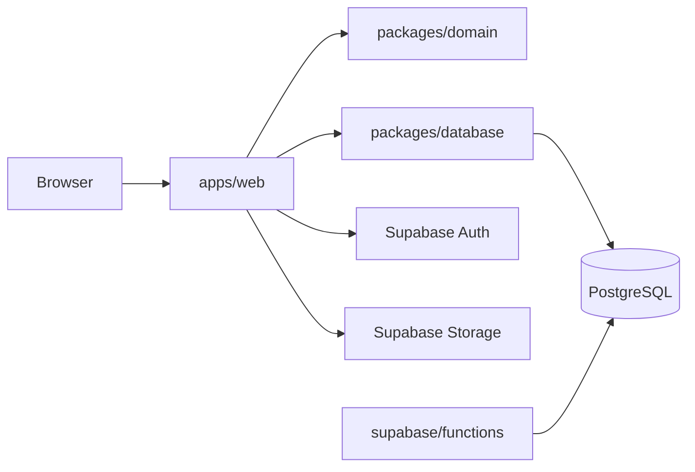

# MDI System Architecture — Supplemental Overview

**Status:** Short conceptual summary. The numbered [System Architecture](06_SYSTEM_ARCHITECTURE.md) specification and current source are authoritative.

MDI is a Domain-Driven Modular Monolith in a pnpm workspace:
- `apps/web`: Next.js App Router web application.
- `packages/domain`: portable TypeScript domain rules.
- `packages/database`: Supabase integration and ordered SQL migrations.
- `supabase/functions`: Edge Function source.

No standalone `@sahitech/ui` workspace package was present in the source tree reviewed on 2026-11-17.

## Core boundaries

- Tenant authorization must be validated on the server and enforced by database grants/RLS/constraints.
- The Global Platform Owner is separate from tenant-scoped roles.
- Supabase Auth, PostgreSQL and Storage are the current application integration model.
- AI, offline/PWA, payment, SMS and other future integrations are not operational merely because they appear in product specifications.

## High-level flow

This is conceptual topology, not a deployment diagram. See [Documentation Sync Policy](DOCUMENTATION_SYNC_POLICY.md) when implementation changes.
